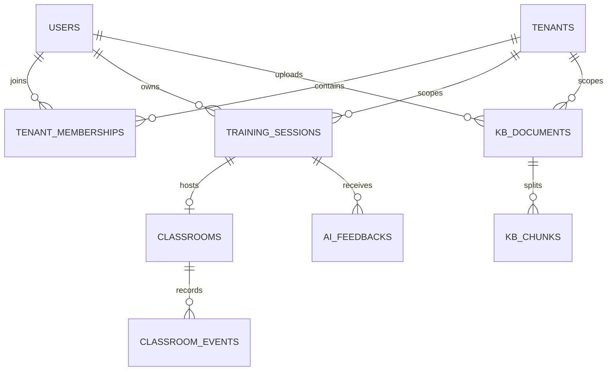

# LINK 多机构数据库与 RAG 接入

## 当前实现

LINK 使用 MySQL 8 作为事务数据和向量切片的主库；现有 NumPy/可选 FAISS 检索器仍是可重建缓存。Alembic 管理增量迁移。新账号首先获得个人工作区，之后可以加入学校/机构。每个机构最多 100 个成员；单个账号最多加入 10 个机构，适用于当前 1–2 所学校、100 个账号以内、5 个并发课堂的试点规模。



`tenants` 保存学校/机构/个人工作区；`tenant_memberships` 是成员角色和状态的来源。`X-Tenant-ID` 只负责选择工作区，服务器对每个请求校验该账号有有效成员关系。缺少该请求头时使用账号的第一个有效工作区。成员接口：

- `GET /api/tenants`：列出可访问工作区及机构角色。
- `POST /api/tenants`：创建个人之外的机构工作区，当前账号成为所有者。
- `GET /api/tenants/{tenant_id}/members`：所有者/管理员查看成员目录。
- `POST /api/tenants/{tenant_id}/members`：所有者/管理员通过已注册账号添加教师、学生或管理员。
- `DELETE /api/tenants/{tenant_id}/members/{user_id}`：移出成员；所有者必须先移交所有权。

请求示例：`X-Tenant-ID: 12`。当前响应中会返回工作区 ID；前端可将所选 ID 保存在本地，并为后续 API 请求附带该请求头。数据库不保存跨设备的个人选择偏好。

## 数据归属与可见性

| 数据 | 保存范围 | 当前访问规则 |
| --- | --- | --- |
| 课程与平台资源 | `tenant_id IS NULL` 为平台目录；也可归到机构 | 平台公开 + 当前机构 |
| 训练、课堂、评课、日志、模型用量 | 记录创建时写入 `tenant_id` | 课堂及个人档案 API 继续按本人 ID 授权；租户归属字段可供后续机构统计 |
| 课堂事件、练习计划 | 通过课堂/训练外键归属 | 先检查课堂所有权，再访问子记录 |
| RAG 文档 | `visibility=public/tenant/private` | 公开语料 + 当前机构语料 + 本人私有资料 |
| RAG 切片和引用 | 通过 `document_id` 继承文档范围 | 文档 ID 筛选由服务端求交，客户端不能扩大范围 |

旧账号各自迁移为个人工作区，原有个人课堂和评课仍归原账号。旧知识库条目保留为公开语料，所以不需要重新嵌入。平台 CNY/USD 成本上限仍是全站硬上限，新增流水带机构归属供统计；机构独立计费需先定义套餐、价格和账单周期。

知识库管理员可以将上传设置为 `tenant`、`private` 或 `public`。公开发布只允许配置的 RAG 管理账号执行。知识库索引、检索、切片详情、审计列表和状态统计都服从同一可见范围。检索内部辅助函数也会执行范围过滤，避免评课流程绕过 API 层。

## 迁移和首次安装

`backend/migrations/versions/20261104_01_multitenant.py` 会给已存在的账号建立个人工作区，并给其旧训练、课堂和评课资料回填租户 ID。首次安装通过完整模型创建空库并登记迁移版本；已有数据库先执行 Alembic 升级。按原有部署命令运行：

```bash
cd backend
python release_admin.py init
```

数据库升级前仍应按现有运维流程制作 MySQL 备份。迁移降级会拒绝删除租户归属字段，恢复需使用升级前备份。

## 公开语料与许可

`sources/rag/manifest.json` 记录随项目提供的 P0 课程知识卡、官方目录索引、来源链接和许可备注。当前语料以项目自编摘要为主，包含中国教育考试网面试大纲目录、教育部精品课评价页面及人民教育出版社教学文章的索引；不抓取或再分发教材、视频、付费附件。确认 RAG 配置和数据库后，可从仓库根目录执行：

```bash
python scripts/rag_ingest_manifest.py --priority P0
```

导入器保留来源 URL 与许可备注。需要将外部资料存入生产知识库前，应先确认原站许可、访问稳定性和可再分发范围；否则只导入独立摘要和官方页面链接。

## RAGFlow 采用边界

本试点先使用 LINK 现有的 MySQL 切片存储、嵌入和混合检索。它能直接继承用户/机构权限，不增加新的数据库服务。RAGFlow 可以作为后续独立检索服务评估，通过 LINK 后端适配器调用；不可让浏览器直接持有 RAGFlow 凭证，也不可把机构权限交给客户端过滤。引入前应先用同一批问题比较命中率、引用准确度、中文切片表现、延迟、备份和许可成本。当前规模无需额外运行完整 RAGFlow 服务栈。

## 尚待产品决策

机构邀请当前以“对方先注册，再由管理员按账号加入”为一期流程；邮箱/短信邀请和审批流程需确定身份验证提供方。租户管理员可见的汇总范围目前体现在归属字段与成员角色上；当前课堂/成长 API 仍默认只返回本人数据，尚未开放管理员跨成员报表。要做机构级管理面板，需要明确管理员能否查看教师/学生明细、课堂录像及可保留期限。
