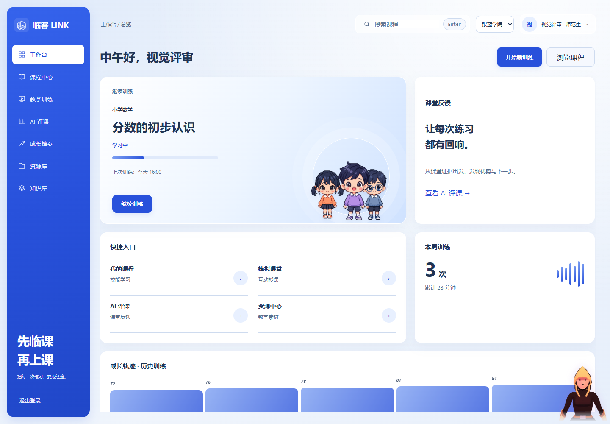
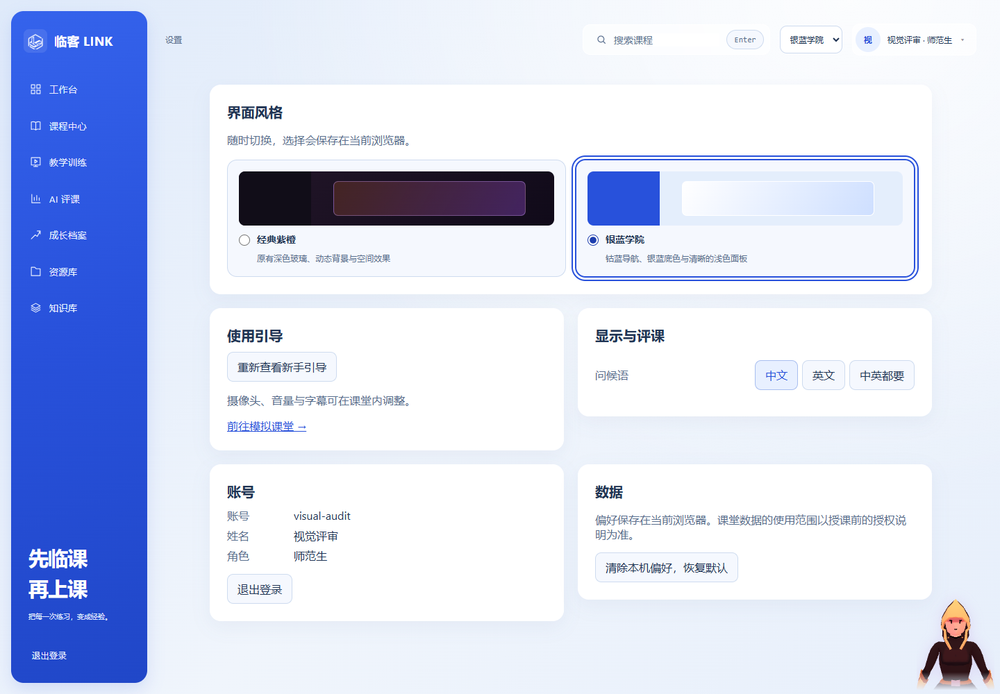
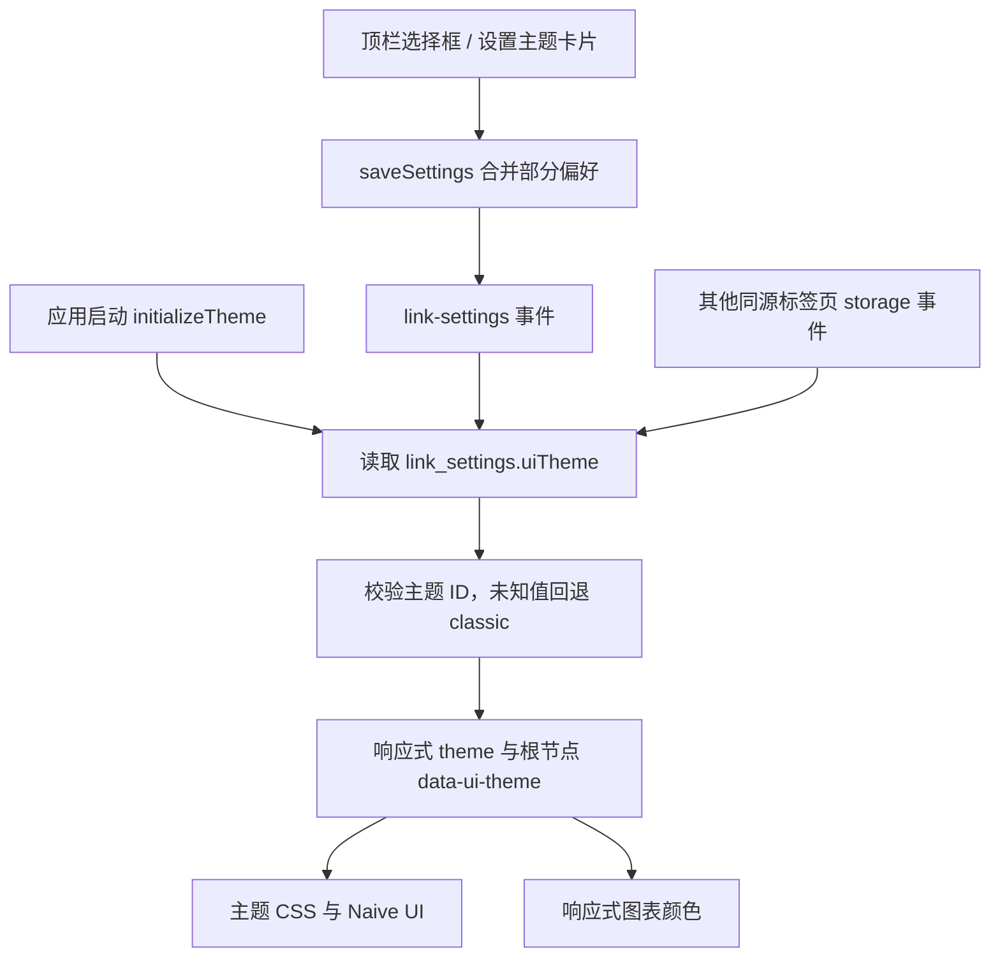

# 临客 LINK 技术更新：银蓝学院主题与风格切换

- 日期：2026-10-14
- 整理基线：`c5f8133`，与本轮整理时的 `origin/main` 一致。
- 范围：前端附加主题、浏览器偏好、图表配色、响应式布局与相关测试。
- 交付边界：代码与技术文档；GitHub 上传不代表生产环境部署。

## 1. 用户可见变化

新增 A+B 方向的「银蓝学院」：银蓝底色、钴蓝导航、浅色内容面板和工作台学生插画。原「经典紫橙」仍是默认主题，继续保留深色玻璃、紫橙配色和原有装饰效果。

登录后可通过顶栏「界面风格」下拉框，或「设置 → 界面风格」中的主题卡片切换。选择保存在当前浏览器，刷新后恢复；清除本机偏好会回到经典紫橙。偏好按浏览器站点保存，不是服务端账号设置，不会跨设备同步。

本次覆盖工作台、课程中心、模拟课堂、AI 评课及历史报告、成长档案、资源库、知识库、个人资料、设置和常用弹窗。登录页保留原有品牌视觉。

以下截图来自实际 Vue 页面，使用隔离的模拟接口与测试账号，数据仅用于视觉验收：





## 2. 设计取舍

### 2.1 附加主题，保留既有样式

既有页面包含大量直接写入 CSS 的颜色，以及组件局部样式。单独替换主色变量会留下深色面板和低对比度文字；整体改写原样式则会影响用户仍需保留的经典风格。

因此新增 `frontend/src/themes/academy.css`，通过根节点属性 `html[data-ui-theme="academy"]` 限定新主题规则。原 `styles.css`、`ambient-effects.css` 和 `functional-ui.css` 保留。新增切换控件具有自己的共享样式；经典主题在窄屏中为该控件新增一行，避免挤压原有页面导航。

样式令牌统一页面背景、内容面板、正文、次要文字、边框、主色、成功和错误状态。课堂与报告的既有变量映射到这些令牌。限定选择器同时处理原有高优先级规则，避免浅色主题出现残留深色背景。

### 2.2 外观状态不作为组件身份

主题是应用级响应式状态，不加入路由参数或组件 `key`。切换只更新 CSS 属性、组件显示条件及配色，不刷新整个页面。原课堂路由按 `route.path` 保持实例的逻辑不变。

工作台中的装饰性 3D 人物在新主题下替换为 `AcademyStudents.vue`，复用已有三名学生 PNG。课堂内的学生舞台、数字人助手及音视频业务保持原实现。新主题停止应用外壳的背景视频、Aurora、点击火花和装饰透视；切回经典主题后恢复相应入口。

这些处理属于外观调整。浏览器验证确认闲置课堂的页面、学生画布和摄像头节点切换前后为同一实例，但未据此宣称真实授课或录像全链路已验收。

## 3. 状态与持久化



| 项目 | 行为 |
| --- | --- |
| 存储键 | 复用 `localStorage.link_settings`，新增 `uiTheme` 字段 |
| 可用值 | `classic`、`academy`；名称与说明集中在 `UI_THEMES` |
| 默认与容错 | 缺失、损坏或未知主题值均显示经典主题 |
| 初始化 | `main.js` 在应用挂载前调用 `initializeTheme()` |
| 同页同步 | 保存与恢复默认通过既有 `link-settings` 事件更新 |
| 跨页同步 | 监听同源标签页的 `storage` 变化及清空操作 |
| 存储失败 | 先保存再应用；写入失败维持当前主题，控件回退并显示错误 |
| 清理 | 初始化返回取消订阅函数；开发热更新时释放旧订阅 |

个人设置页此前会把加载时的整份设置快照写回。主题可在顶栏单独修改后，这种做法可能让另一个设置操作把主题覆盖回旧值。本次将设置保存改为 `saveSettings({ [key]: value })`，由已有帮助函数合并最新偏好，防止陈旧快照覆盖。

## 4. 图表、弹窗和交互适配

ECharts 使用画布，不能依赖普通 CSS 继承文字颜色。`useChartColors()` 在经典主题下原样返回颜色，新主题下映射文字、坐标线、提示框、曲线和面积色。图表 `computed` 读取主题状态，切换时重新计算配置；历史评课的公共提示框配置也改为响应式计算。

Naive UI 在已登录工作区按主题选择浅色或深色配置。传送到 `body` 的课堂对话框、阅读器和助手面板使用根节点主题属性匹配，避免依赖已离开的父容器。

摄像头占位画面采用浅色标签；真实视频上方的字幕和计时保留深色承托与浅色文字，确保其可读性不依赖摄像画面内容。图片、视频及课堂 3D 画布本身不做整体反色。

切换入口使用原生 `select` 与 `fieldset` / `radio`，提供名称、键盘操作与焦点样式。窄屏布局中，银蓝主题的数字人入口放在右下角，经典主题保留原入口位置。用户拖动后的内联位置继续由原有拖拽逻辑管理。

## 5. 文件导航

| 文件 | 职责 |
| --- | --- |
| `frontend/src/utils/uiTheme.js` | 主题列表、响应式状态、持久化同步、Naive UI 配置与图表颜色映射 |
| `frontend/src/utils/settings.js` | 新增默认主题字段，复用既有设置存取和事件 |
| `frontend/src/components/ThemeSwitcher.vue` | 顶栏选择框、设置卡片及存储失败反馈 |
| `frontend/src/components/AcademyStudents.vue` | 新主题工作台学生装饰，复用本地图片 |
| `frontend/src/themes/academy.css` | 新主题令牌、页面与弹窗覆盖、响应式规则 |
| `frontend/src/main.js`、`App.vue` | 初始化、全局样式及 UI 库主题接入 |
| `frontend/src/layouts/AppShell.vue` | 顶栏入口、钴蓝导航和装饰效果按主题显示 |
| `frontend/src/utils/ambientUi.js` | 外观效果动态停用、恢复与订阅释放 |
| `frontend/src/views/ProfileView.vue` | 设置卡片和部分偏好写入 |
| `frontend/src/views/DashboardView.vue`、`GrowthView.vue`、`AiReviewView.vue` | 工作台装饰和图表配色接入 |
| `frontend/tests/uiTheme.test.mjs` | 默认兼容、保存、跨标签页同步、失败回退和颜色恢复测试 |

既有页面交互测试补齐新增模块依赖；个人设置测试同步验证部分偏好写入。没有新增运行时依赖、外部图片请求、后端接口、数据库迁移或环境变量。

## 6. 验证记录与边界

| 检查 | 本次结果 |
| --- | --- |
| 前端 `npm test` | 175 项通过，0 失败；其中新增 5 项主题行为测试 |
| 前端 `npm run build` | 通过；仍有 Three.js / 图表资源包大于 500 kB 的提示 |
| 首次进入与刷新 | 老偏好默认经典；选择银蓝后刷新恢复 |
| 切换与恢复 | 双向切换、设置卡片、其他偏好写入和清除本机偏好符合预期 |
| 页面连续性 | 表单草稿保留；闲置课堂页面、学生画布、摄像头节点保持同一实例 |
| 主要布局 | 工作台、课程、课堂、报告、设置在 320 / 768 / 1024 / 1440 像素宽度检查，无整页横向溢出 |
| 弹窗与历史页面 | 检查课前准备、课程详情、历史趋势、历史报告空状态及助手面板 |
| 原主题窄屏 | 320 像素下导航和账户按钮可见，新增主题控件独立成行 |
| 浏览器运行 | 本轮隔离浏览器检查未发现页面脚本错误 |

复现前端自动检查：

```powershell
npm test --prefix frontend
npm run build --prefix frontend
```

浏览器检查使用隔离的模拟接口，未连接真实课堂服务，也未调用摄像头或麦克风。本次没有重新运行后端全量测试，没有进行真实设备录像、语音、长期授课和实体触屏验收。截图与界面检查不能替代这些端到端验证。

## 7. 升级、回退与后续维护

更新前端代码后，使用既有锁文件安装依赖并构建：

```powershell
npm ci --prefix frontend
npm run build --prefix frontend
```

按项目已有流程部署生成的前端静态资源。开发启动、API 代理和完整课堂环境配置继续参照 [运行说明](classroom-runbook.md)。本次无后端或数据库升级要求。

用户可直接切回「经典紫橙」；若需撤销代码改造，回退主题功能提交及对应文档提交后重新构建。新增存储字段不影响旧设置读取。无需清空其他偏好或用户数据。

后续新增页面应同时检查两套风格，并优先使用语义颜色令牌。画布图表通过 `useChartColors()` 接入；传送弹窗用根主题属性限定；不得把主题加入课堂组件的 `key`。现有 CSS 覆盖较多，后续修改高优先级旧样式时，需要复查浅色主题对比度、焦点状态、摄像画面覆盖层和窄屏布局。

## 8. 相关文档

- [沉浸课堂、数字人助手与图检索技术更新](技术更新-沉浸课堂与数字人助手-20261008.md)
- [数字人助手与新手导览](ui-assistant-onboarding.md)
- [原视觉与动效集成](ui-effects-integration.md)
- [历史技术交接入口](技术沉淀.md)
